<div align="center">

# CloudDevOpsProject

**A production-style DevOps platform for the iVolve microservices application on AWS:**
**Terraform, Ansible, Kubernetes (Helm) and a fully automated CI/CD pipeline on GitHub Actions.**


</div>

---

## Table of contents

1. [Overview](#1-overview)
2. [Architecture](#2-architecture)
3. [System flow](#3-system-flow)
4. [Tech stack](#4-tech-stack)
5. [Repository structure](#5-repository-structure)
6. [Requirements coverage](#6-requirements-coverage)
7. [Getting started](#7-getting-started)
8. [Evidence](#8-evidence)
9. [Security](#9-security)
10. [Cost control and cleanup](#10-cost-control-and-cleanup)
11. [Limitations and roadmap](#11-limitations-and-roadmap)

---

## 1. Overview

iVolve is a small three-tier web application: a Node.js **frontend**, a Python **auth-service** (sign up / log in, backed by MySQL) and a Java **roadmap-service**. This project takes it from source code to a running, continuously delivered system on AWS, with every layer defined as code.

| Service | Technology | Port | Runtime notes |
|---|---|---|---|
| `frontend` | Node.js 22 (Express) | 3000 | calls the other services server-side; 1 replica (in-memory sessions) |
| `auth-service` | Python 3.12 (Flask) | 5000 | 2 replicas, readiness probe on `/health` |
| `roadmap-service` | Java 21, Spring Boot 4 | 8080 | probe on `/api/roadmap` |
| MySQL 8 | StatefulSet + EBS gp3 | 3306 | database `ivolve`, headless service `mysql-headless` |

### Highlights

- **Everything is code.** VPC, subnets, NAT, NACLs, EKS, ECR, the CI server, its configuration, the Kubernetes manifests and the pipelines are all versioned in this repository.
- **High availability by design.** Two Availability Zones, one EKS node group (one node) per private subnet, so the two worker nodes always sit in different AZs.
- **Private by default.** Worker nodes live in private subnets and reach the internet only through a NAT Gateway; only the load balancer and the CI runner are in public subnets.
- **Security gate before the registry.** Trivy scans every image *before* it is pushed; HIGH/CRITICAL findings fail the pipeline, so a vulnerable image never reaches ECR (see [section 8.4](#84-the-security-gate-in-action)).
- **Traceable deployments.** Each deploy is a Git commit that changes one image tag (the first 7 characters of the commit SHA), then `helm upgrade --atomic` rolls it out and rolls back automatically on failure.
- **Reusable pipeline.** One reusable workflow (the "shared library") serves all three microservices; each service has a tiny caller workflow.
- **Stateful workload done properly.** MySQL runs as a StatefulSet on an EBS gp3 volume provisioned through the EBS CSI driver, with credentials granted by EKS Pod Identity (no node-wide permissions).
- **Free-tier aware.** `t3.small` nodes with VPC CNI prefix delegation (raises the 11-pod-per-node limit), a single NAT gateway, and a documented stop/restore procedure to control cost.

---

## 2. Architecture

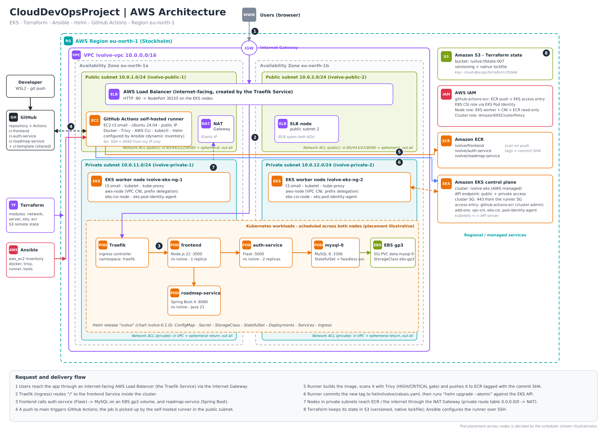

*The numbered markers match the "Request and delivery flow" legend inside the diagram. Source: [`docs/architecture.svg`](docs/architecture.svg).*

### Network design

| Layer | Details |
|---|---|
| VPC | `10.0.0.0/16` in `eu-north-1`, DNS support + hostnames enabled |
| Public subnets | `10.0.1.0/24` (AZ a) and `10.0.2.0/24` (AZ b): route to the Internet Gateway; hold the AWS load balancer, the NAT Gateway and the CI runner |
| Private subnets | `10.0.11.0/24` (AZ a) and `10.0.12.0/24` (AZ b): default route to the NAT Gateway; hold the EKS worker nodes |
| Network ACLs | public: inbound 80/443/22/8080 + ephemeral ports; private: inbound from the VPC + ephemeral return traffic; outbound open |
| Security groups | runner: SSH and 8080 only from the operator IP; EKS cluster SG: 443 from the runner SG (so the pipeline can reach the API server) |
| Egress | one NAT Gateway (single AZ) for the private route table; chosen to limit cost |
| Subnet tags | `kubernetes.io/role/elb` and `internal-elb` so Kubernetes picks the right subnets for load balancers |

### Main components

| Component | Purpose |
|---|---|
| Amazon EKS `ivolve-eks` | managed control plane, 2 managed node groups (`t3.small`), add-ons: VPC CNI, EBS CSI, Pod Identity agent |
| Amazon ECR | three repositories: `ivolve/frontend`, `ivolve/auth-service`, `ivolve/roadmap-service` (scan on push) |
| Amazon S3 | Terraform remote state (`ivolve-tfstate-007`, versioning + native lockfile) |
| EC2 runner | GitHub Actions self-hosted runner (Docker, Trivy, AWS CLI, kubectl, Helm), configured by Ansible |
| Traefik | ingress controller exposed through an AWS load balancer |
| IAM | pipeline user with ECR push + an EKS access entry; Pod Identity role for the EBS CSI driver |

---

## 3. System flow

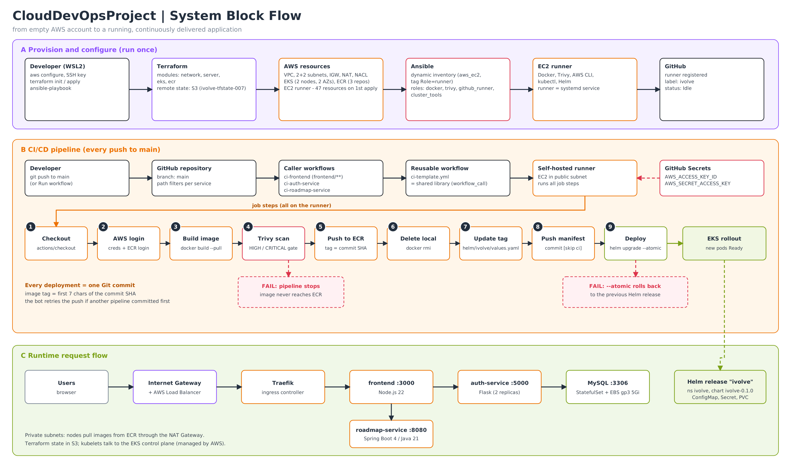

*Source: [`docs/system-flow.svg`](docs/system-flow.svg).*

### Pipeline stages

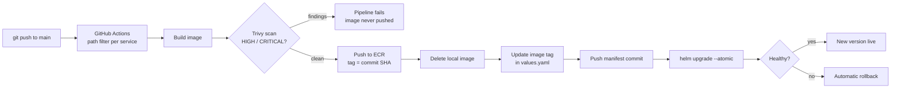

### Design decisions

| Decision | Why |
|---|---|
| Scan **before** push | a vulnerable image never lands in the registry |
| Tag = first 7 chars of the commit SHA | immutable, traceable; no `latest` in production manifests |
| Commit the new tag to Git (`[skip ci]`) | the repository always describes what is deployed; the commit is the audit trail |
| `helm upgrade --install --atomic --timeout 10m` | waits for readiness and rolls back automatically on failure |
| One reusable workflow + three callers | no duplicated pipeline logic (the "shared library") |
| Self-hosted runner in the VPC | reaches the EKS API server privately and reuses Docker layer cache |
| Push retry with fresh checkout | three pipelines can finish at the same time without merge conflicts on `values.yaml` |

---

## 4. Tech stack

| Area | Tools |
|---|---|
| Cloud | AWS: VPC, EKS, ECR, EC2, S3, IAM, ELB |
| Infrastructure as Code | Terraform (modules: `network`, `server`, `eks`, `ecr`; S3 backend with native locking) |
| Configuration management | Ansible (dynamic inventory `amazon.aws.aws_ec2`, roles: `docker`, `trivy`, `github_runner`, `cluster_tools`) |
| Containers | Docker (multi-stage builds), Docker Compose for local runs |
| Orchestration | Kubernetes on EKS, Helm chart `ivolve`, Traefik ingress |
| CI/CD | GitHub Actions (reusable workflow, self-hosted runner), Trivy |
| Storage | EBS gp3 through the EBS CSI driver, StorageClass `ebs-gp3` |

---

## 5. Repository structure

```text
.
|-- .github/workflows/     ci-template.yml (shared library) + ci-frontend / ci-auth-service / ci-roadmap-service
|-- frontend/              Node.js service + Dockerfile
|-- auth-service/          Flask service + Dockerfile
|-- roadmap-service/       Spring Boot service + Dockerfile
|-- docker-compose.yml     local stack (3 services + MySQL)     .env.example
|-- terraform/             versions.tf main.tf variables.tf outputs.tf modules/{network,server,eks,ecr}
|-- ansible/               ansible.cfg, inventory/aws_ec2.yml, site.yml, roles/{docker,trivy,github_runner,cluster_tools}
|-- helm/ivolve/           Chart.yaml, values.yaml, templates/
`-- docs/                  architecture + flow diagrams, screenshots
```

---

## 6. Requirements coverage

| # | Requirement | Delivered | Where |
|---|---|---|---|
| 1 | GitHub repository with README | yes | this repository |
| 2 | `docker-compose.yml` (app + database) | yes | [`docker-compose.yml`](docker-compose.yml) |
| 3 | Terraform: network, server, EKS (2 nodes, different private subnets/AZs), ECR, S3 backend | yes | [`terraform/`](terraform) |
| 4 | Ansible: roles, dynamic inventory, tools on the CI server | yes (see note) | [`ansible/`](ansible) |
| 5 | Kubernetes: namespace, Deployments, Services, StatefulSet, headless Service, StorageClass, ConfigMap, Secret, Ingress | yes, as a Helm chart | [`helm/ivolve/`](helm/ivolve) |
| 6 | Pipeline per microservice with Build, Scan, Push, Delete locally, Update manifests, Push manifests, using a shared library | yes (see note) | [`.github/workflows/`](.github/workflows) |
| 7 | Continuous deployment | yes (see note) | final step of the pipeline |
| 8 | Documentation: setup instructions and architecture overview | yes | this file + [`docs/`](docs) |

**Differences from the original brief (by design)**

- **GitHub Actions replaces Jenkins.** The EC2 instance from the Terraform `server` module is configured by Ansible as a GitHub self-hosted runner (Docker, Trivy, AWS CLI, kubectl, Helm) instead of a Jenkins server, and the "shared library" is a reusable workflow.
- **Helm replaces plain YAML files.** The same Kubernetes resources are templated from one `values.yaml`.
- **Deployment is performed by the pipeline** (`helm upgrade --atomic` after the manifest commit) instead of a pull-based controller. See the roadmap for the GitOps option.
- **Traefik replaces `ingress-nginx`**, which was retired upstream in 2026.

---

## 7. Getting started

### Prerequisites

`git`, Docker Engine, AWS CLI v2, Terraform >= 1.10, `kubectl`, `helm`, Ansible with `boto3`, and an AWS account with credentials configured (`aws configure`). On Windows use WSL2 Ubuntu.

### 7.1 Run locally

```bash
cp .env.example .env
docker compose up -d --build
# http://localhost:3000  ->  sign up, log in, open the roadmap
docker compose down
```

### 7.2 Provision AWS (Terraform)

```bash
export AWS_REGION=eu-north-1
export TF_BUCKET=ivolve-tfstate-007
aws s3api create-bucket --bucket $TF_BUCKET --region $AWS_REGION --create-bucket-configuration LocationConstraint=$AWS_REGION
aws s3api put-bucket-versioning --bucket $TF_BUCKET --versioning-configuration Status=Enabled

ssh-keygen -t ed25519 -f ~/.ssh/ivolve-key -N ""

# IAM user used by the pipeline (it must exist before `terraform apply`, which grants it an EKS access entry)
aws iam create-user --user-name github-actions-ecr
aws iam attach-user-policy --user-name github-actions-ecr --policy-arn arn:aws:iam::aws:policy/AmazonEC2ContainerRegistryPowerUser
aws iam put-user-policy --user-name github-actions-ecr --policy-name eks-describe --policy-document '{"Version":"2012-10-17","Statement":[{"Effect":"Allow","Action":"eks:DescribeCluster","Resource":"*"}]}'
aws iam create-access-key --user-name github-actions-ecr      # keep the keys for step 7.5

cd terraform
export TF_VAR_my_ip_cidr="$(curl -s https://checkip.amazonaws.com)/32"
terraform init
terraform apply
aws eks update-kubeconfig --region eu-north-1 --name ivolve-eks
kubectl get nodes -L topology.kubernetes.io/zone
```

The runner security group only accepts SSH from `my_ip_cidr`: re-run the `export` and `terraform apply` whenever your public IP changes.

### 7.3 Configure the runner (Ansible)

```bash
cd ansible
python3 -m venv ~/ansible-venv && source ~/ansible-venv/bin/activate
pip install ansible boto3 botocore
ansible-galaxy collection install amazon.aws
export AWS_REGION=eu-north-1

ansible-inventory --graph        # dynamic inventory: EC2 tagged Role=runner
ansible-playbook site.yml -e github_repo_url=https://github.com/<USER>/<REPO> -e github_runner_token=<TOKEN>
```

Get `<TOKEN>` from GitHub: Settings, Actions, Runners, New self-hosted runner. To (re)install only the cluster tools: `ansible-playbook site.yml --tags tools -e github_repo_url=x -e github_runner_token=unused`.

### 7.4 Ingress controller

```bash
helm repo add traefik https://traefik.github.io/charts && helm repo update
helm install traefik traefik/traefik -n traefik --create-namespace
kubectl get svc traefik -n traefik       # EXTERNAL-IP = load balancer hostname
```

### 7.5 Pipeline secrets

GitHub, Settings, Secrets and variables, Actions, New repository secret: `AWS_ACCESS_KEY_ID` and `AWS_SECRET_ACCESS_KEY`. Then Settings, Actions, General: Workflow permissions set to **Read and write**, and "Require approval for all outside collaborators" (the runner executes workflows on your EC2 instance).

### 7.6 Deploy

Push to `main` (or use **Run workflow**). Each pipeline builds, scans, pushes, updates the image tag in `helm/ivolve/values.yaml` and deploys. A manual deploy is also possible:

```bash
helm upgrade --install ivolve helm/ivolve -n ivolve --create-namespace --set createNamespace=false --atomic --timeout 10m
```

### 7.7 Verify

```bash
helm list -n ivolve
kubectl get pods,pvc,ingress -n ivolve
curl -I http://<LOAD_BALANCER_HOSTNAME>
```

---

## 8. Evidence

### 8.1 Infrastructure

Terraform created the whole environment (47 resources on the first apply) and printed the outputs used later by the pipeline:

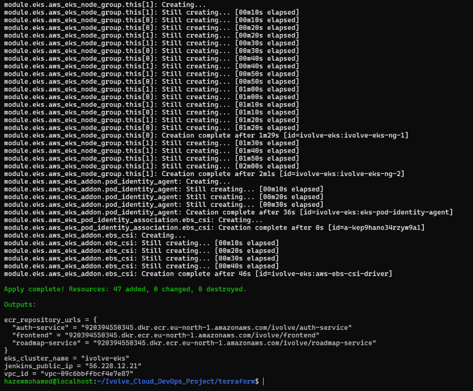

```text
Apply complete! Resources: 47 added, 0 changed, 0 destroyed.

ecr_repository_urls = {
  "auth-service"    = "920394550345.dkr.ecr.eu-north-1.amazonaws.com/ivolve/auth-service"
  "frontend"        = "920394550345.dkr.ecr.eu-north-1.amazonaws.com/ivolve/frontend"
  "roadmap-service" = "920394550345.dkr.ecr.eu-north-1.amazonaws.com/ivolve/roadmap-service"
}
eks_cluster_name  = "ivolve-eks"
```

Compute: the CI runner in the public subnet plus the two EKS worker nodes, one per Availability Zone (the runner kept its original `ivolve-jenkins` Name tag in this first-apply screenshot and was renamed `ivolve-runner` afterwards):

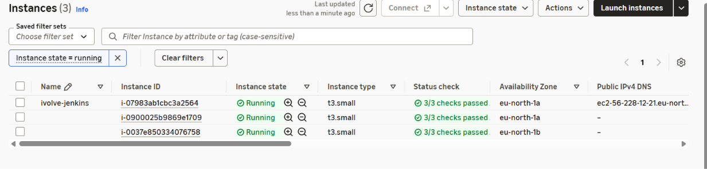

Terraform state stored remotely in S3:

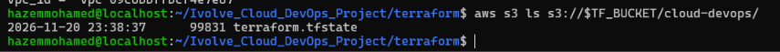

EKS add-ons healthy: VPC CNI (`aws-node`), CoreDNS, EBS CSI driver, Pod Identity agent and kube-proxy on both nodes:

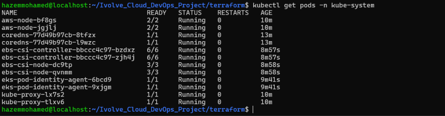

### 8.2 CI/CD pipelines

One workflow per microservice, all green:

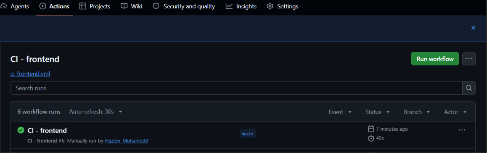
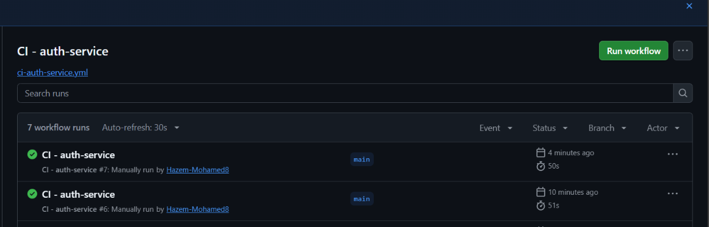
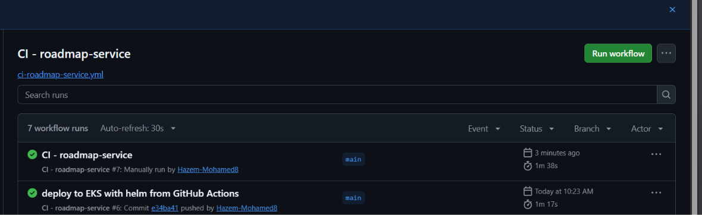

A complete run, from build to `helm upgrade` on EKS, in about one minute:

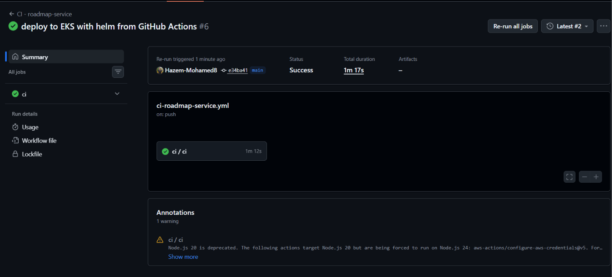

### 8.3 Running workloads

```text
$ helm list -n ivolve
NAME    NAMESPACE   REVISION   UPDATED                                  STATUS     CHART          APP VERSION
ivolve  ivolve      5          2026-11-22 11:48:19.924736583 +0000 UTC  deployed   ivolve-0.1.0   1.0.0

$ kubectl get pods,pvc,ingress -n ivolve
NAME                                   READY   STATUS    RESTARTS   AGE
pod/auth-service-cfb984984-fkkkx       1/1     Running   0          17m
pod/auth-service-cfb984984-vh79g       1/1     Running   0          17m
pod/frontend-5c6c5ffbd4-tzrsc          1/1     Running   0          20m
pod/mysql-0                            1/1     Running   0          3h17m
pod/roadmap-service-557fd95446-x8mjz   1/1     Running   0          16m

NAME                                 STATUS   VOLUME                                     CAPACITY   ACCESS MODES   STORAGECLASS
persistentvolumeclaim/data-mysql-0   Bound    pvc-51ed02ba-288d-4b81-95e9-a759de39b27c   5Gi        RWO            ebs-gp3

NAME                                         CLASS     HOSTS   ADDRESS                                                                   PORTS
ingress.networking.k8s.io/frontend-ingress   traefik   *       abd3b5f9b270f4d2cb212ca6654c6a61-1889353207.eu-north-1.elb.amazonaws.com  80

$ curl -s -o /dev/null -w "%{http_code}\n" http://abd3b5f9b270f4d2cb212ca6654c6a61-1889353207.eu-north-1.elb.amazonaws.com
200
```

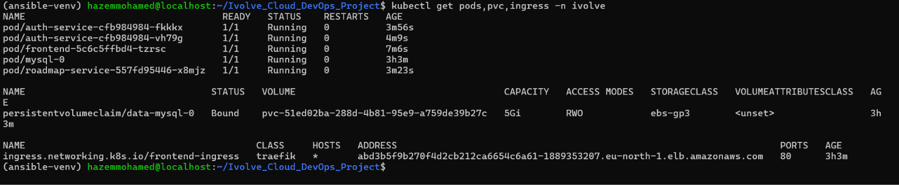

The ingress controller is exposed through an internet-facing AWS load balancer:

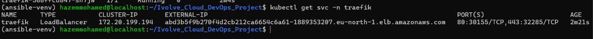

<!-- Add a browser screenshot of the application (sign up / log in / roadmap) as docs/screenshots/11-application.png, then uncomment:

-->

### 8.4 The security gate in action

The first pipeline runs were **blocked by Trivy**, which is exactly its job. Each finding was fixed at the source instead of being ignored:

| Service | What Trivy found | Fix |
|---|---|---|
| `auth-service` | `zlib1g` HIGH vulnerability in the Debian base image | `docker build --pull` plus `apt-get upgrade` in the Dockerfile |
| `frontend` | 10 HIGH findings, all inside the *bundled npm* (`brace-expansion`, `ip-address`, `pacote`, `picomatch`, `sigstore`); the application's own dependencies were clean | npm is removed from the runtime image, the container starts `node server.js` directly and runs as the non-root `node` user |
| `roadmap-service` | 32 findings (9 CRITICAL) in Spring Boot 3.5, Spring Framework, Tomcat and Jackson, plus a HIGH in a Go binary shipped with the base image | upgrade to Spring Boot 4.0.9 and switch to an Alpine JRE base image running as a non-root user |

Because the scan runs before the push, none of the vulnerable images was ever stored in ECR.

---

## 9. Security

- **Network:** worker nodes have no public IPs; ingress only through the load balancer; NACLs plus security groups; the EKS API is reachable from the runner through a security-group-to-security-group rule.
- **Identity:** the pipeline user has only ECR push and one EKS access entry; the EBS CSI driver gets its permissions through EKS Pod Identity instead of node-wide roles; nodes have ECR read-only.
- **Supply chain:** Trivy is installed from a pinned release by Ansible; images are scanned before they are pushed; the runner approval policy for outside collaborators is enabled.
- **Containers:** minimal runtime images, non-root users, no package managers left in the Node image.
- **Secrets:** pipeline keys live in GitHub Secrets and the Terraform state is in a private versioned bucket. The Kubernetes `Secret` values in `values.yaml` are lab values; see the roadmap.

---

## 10. Cost control and cleanup

The EKS control plane and the NAT Gateway are billed per hour and cannot be stopped, only removed. Both are fully reproducible from code.

Pause (keeps the VPC, ECR, S3 and the runner):

```bash
helm uninstall ivolve -n ivolve; kubectl delete namespace ivolve     # also removes the EBS volume
helm uninstall traefik -n traefik                                      # removes the AWS load balancer
cd terraform
terraform destroy -target=module.eks -target=module.network.aws_nat_gateway.this -target=module.network.aws_eip.nat
```

Restore: `terraform apply`, `aws eks update-kubeconfig ...`, `helm install traefik ...`, then re-run a pipeline.

Full teardown: the steps above, then `terraform destroy`, delete the S3 bucket and the IAM user, and remove the runner from GitHub (Settings, Actions, Runners).

---

## 11. Limitations and roadmap

| Item | Today | Next step |
|---|---|---|
| Continuous deployment | pipeline-driven `helm upgrade --atomic` | pull-based GitOps with Argo CD watching `helm/ivolve` |
| AWS authentication | access keys in GitHub Secrets | GitHub OIDC with a short-lived IAM role |
| Kubernetes secrets | lab values in `values.yaml` | Sealed Secrets or External Secrets + AWS Secrets Manager |
| frontend scaling | 1 replica (in-memory sessions) | Redis session store, then HPA |
| Observability | `kubectl` and workflow logs | Prometheus, Grafana and alerting |
| TLS and DNS | HTTP on the load balancer hostname | cert-manager + Route 53 |
| Egress | single NAT Gateway | one NAT per AZ for resilience |
| Runner | one static EC2 runner | autoscaling runners (actions-runner-controller) |
| Terraform | applied from a workstation | `terraform plan` on pull requests |

---

<div align="center">

Built by **Hazem** ([@Hazem-Mohamed8](https://github.com/Hazem-Mohamed8)) as the NTI Cloud DevOps final project.

</div>
